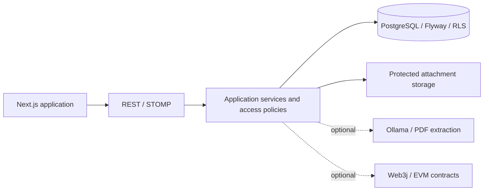

# Client Hub — Backend

A Java / Spring Boot backend for a shared client–freelancer workspace: projects, tasks, contextual discussions, invoices, and an auditable history of work.

Client Hub brings coordination and payment records into one application. Its core is a conventional Web2 system; human-reviewed AI task drafting and blockchain escrow/audit anchoring are optional extensions.

[Frontend](https://github.com/Triet1705/client-hub-frontend) · [Smart contracts](https://github.com/Triet1705/client-hub-contracts)

## What it does

- **Workspace access:** tenant-aware authentication, refresh-token rotation, and ADMIN / CLIENT / FREELANCER roles with project and record-level access policies.
- **Project delivery:** project ownership and membership, scoped tasks, assignment, status transitions, and progress tracking.
- **Contextual communication:** discussions attached to projects, tasks, or invoices; protected attachment downloads and a project activity timeline.
- **Billing:** invoice lifecycle management and cumulative project-budget checks. FIAT status records represent application bookkeeping, not proof of bank settlement.
- **Operations:** an admin control center, application audit records, health endpoints, notifications, and STOMP event delivery.
- **Optional AI:** extract draft tasks from a PDF through Ollama. Users review the drafts before creating tasks through the ordinary task workflow.
- **Optional Web3:** whole-invoice ERC-20 escrow and Merkle-root commitments for audit batches, with confirmation and reconciliation logic.

## Architecture

The backend is a **modular monolith**, packaged as one executable Spring Boot application.



| Maven module | Responsibility |
| --- | --- |
| `client-hub-common` | Shared context, exceptions, and utilities |
| `client-hub-domain` | Entities, repository contracts, enums, and events |
| `client-hub-application` | Use cases, DTOs, policies, and tenant-aware services |
| `client-hub-infrastructure` | Security, persistence, AI, and storage adapters |
| `client-hub-web3` | Escrow integration, audit anchoring, listeners, and reconciliation |
| `client-hub-web` | REST controllers, WebSocket configuration, and application entry point |

Authenticated tenant identity comes from the JWT. Service-level tenant and relationship checks remain authoritative; PostgreSQL row-level security supplies an additional database boundary. Administrative operations have their own scope and must not be assumed to behave like ordinary client queries.

Normal discussion attachments use backend filesystem storage. MinIO supports the optional AI document path; its presence does not mean every attachment is stored in object storage.

## Run locally

Prerequisites: **JDK 21**, Docker with Compose for the supplied infrastructure, and the included Maven wrapper. The examples use PowerShell; on Linux/macOS use `./mvnw` and your shell's environment-variable syntax.

### 1. Configure local infrastructure

From this repository, copy `.env.example` to `.env` if you do not already have a local configuration. Review its values before starting services.

```powershell
if (!(Test-Path .env)) { Copy-Item .env.example .env }
docker compose -f docker-compose.dev.yml up -d postgres redis
```

The Compose defaults expose PostgreSQL at `localhost:5433` and Redis at `localhost:6379`. Set the database and Redis variables in the application process to the same values used by Compose.

**Spring Boot does not automatically load this `.env` file.** Supply variables through your shell or IDE. Compose reading `.env` does not configure a separately launched Java process.

### 2. Configure the application

| Setting | Purpose |
| --- | --- |
| `DB_HOST`, `DB_PORT`, `DB_NAME`, `DB_USER`, `DB_PASS` | PostgreSQL connection; match the local infrastructure |
| `JWT_SECRET` | A securely generated signing secret of at least 32 characters; keep it stable across local restarts |
| `REDIS_HOST`, `REDIS_PORT`, `REDIS_PASSWORD` | Match the Redis service |
| `AI_ENABLED` | Set `false` for a Web2-only run |
| `BLOCKCHAIN_ENABLED`, `AUDIT_ANCHOR_ENABLED` | Set `false` for a Web2-only run |
| `file.upload-dir` (Spring property) | Writable local directory for discussion attachments |

For the first Web2 run, after supplying connection values and `JWT_SECRET`:

```powershell
$env:AI_ENABLED = 'false'
$env:BLOCKCHAIN_ENABLED = 'false'
$env:AUDIT_ANCHOR_ENABLED = 'false'
$clientHubUploadPath = Join-Path $PWD 'uploads'
./mvnw.cmd clean package -DskipTests
java "-Dfile.upload-dir=$clientHubUploadPath" -jar client-hub-web/target/client-hub-web-0.0.1-SNAPSHOT.jar
```

Packaging with `-DskipTests` is a startup step, not validation. Flyway runs on application startup; use a dedicated development database. The backend defaults to port **8080**, with business endpoints under `/api`.

- Swagger UI: `http://localhost:8080/swagger-ui/index.html`
- OpenAPI: `http://localhost:8080/v3/api-docs`
- Health: `http://localhost:8080/actuator/health`

Use the [frontend setup](https://github.com/Triet1705/client-hub-frontend#run-locally) to open the UI. Registration/login includes a workspace tenant; email alone is not the account lookup boundary.

### Optional services

AI extraction needs Ollama with the configured model and the MinIO document-storage configuration. Inspect `ai.ollama.*` and `minio.*` in [application.properties](client-hub-web/src/main/resources/application.properties). The supplied Compose Ollama service requests an NVIDIA GPU; adapt that service deliberately for a CPU-only machine.

For Web3, follow the [contracts bootstrap instructions](https://github.com/Triet1705/client-hub-contracts#local-web3-workflow), pass the generated addresses to the actual Java process, and restart both applications. A connected wallet is not automatically a bound Client Hub wallet.

## Verification

```powershell
# Default suite and build checks
./mvnw.cmd clean verify

# Additional integration-tagged web-module tests; requires Docker
./mvnw.cmd verify -Pintegration-tests
```

Run both commands for their respective coverage: the integration profile selects tagged tests and is not a substitute for the default suite. Tests include service policies, controller behavior, and PostgreSQL/RLS integration. See the POMs for module-specific selection.

The [Maven workflow](.github/workflows/maven.yml) also includes dependency checks and coverage publication. A failed coverage upload and a failed test are different outcomes; inspect individual job steps rather than interpreting the overall badge alone.

## Scope and known limits

This is a portfolio/research application with a bounded Web2 deployment history, not a claim of production readiness.

- Whole-invoice escrow is implemented; milestone payments are not.
- `WorkCertificate` exists in the contracts repository, but application-side certificate minting currently simulates persistence rather than submitting a real mint transaction.
- Project Files aggregates discussion attachments; it is not a full document-management system.
- AI contract-risk analysis, automatic time-to-invoice billing, and several broader roadmap features are not delivered features.
- Historical hosted evaluation found realtime/recovery and observable account-lockout failures. Later source changes do not establish that those hosted scenarios have been revalidated.
- Optional AI, blockchain, and audit anchoring were disabled in the evaluated hosted Web2 release. Local integration evidence does not establish testnet/mainnet or real-money readiness.

For deployment, review [the production configuration template](client-hub-web/src/main/resources/application-prod.example.properties): use separate migration/runtime database credentials, persistent upload storage, explicit CORS origins, appropriate cookie settings, and deliberate feature flags. The local Compose setup is not a production deployment recipe.
